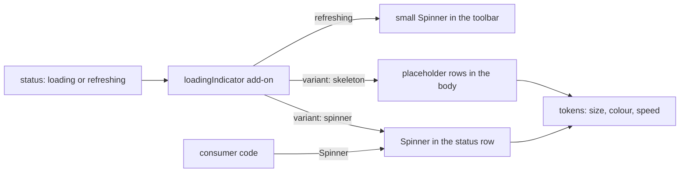

# Specification: loading-indicators

> **Status**: Specified, not built. Stages 1 and 2 written; stages 3 onward pending.
> **Stage entry**: 1
> **Semver impact**: minor (a new add-on, a standalone `Spinner` component and new CSS tokens; no default changes; see api-surface.md)

---

## 1. The consumer problem

While a grid loads, it shows the word "Loading…" in one table cell and nothing else. That leaves a consumer
three gaps:

1. **There is no spinner.** A developer who wants one builds it, and most reach for a spinner package, which
   is a dependency in an app that chose this grid partly because it has none.
2. **There is no skeleton.** The table collapses to a single text row, so the page jumps when rows arrive: the
   header and column widths hold (that is deliberate), but the body goes from one line to a full page.
3. **A refresh is nearly invisible.** `refreshing` keeps the old rows and sets `aria-busy` with a dimmed body.
   Nothing says that work is going on, so a slow server looks like a dead button.

The package has a rule that makes the obvious fix unavailable: **zero runtime dependencies**. So the
indicators have to be drawn by the package itself, from SVG, CSS and markup, with no icon font, no image, no
library and no inline script.

## 2. User stories

- **US-01.** As a person waiting for data, I want to see that something is happening, in a form that matches the
  size of what is about to appear.
- **US-02.** As a developer, I want to choose between a spinner and a skeleton with one option, and between a
  handful of spinner styles, without installing anything.
- **US-03.** As a developer, I want the same spinners as a component I can use outside the grid (a button,
  a panel, a tree node), so my app looks consistent.
- **US-04.** As a developer with a design language, I want to recolour, resize and re-time every indicator with
  CSS custom properties, and to replace one entirely with my own element.
- **US-05.** As a person who is sensitive to motion, I want the animation to stop, and the grid to still say it is loading.
- **US-06.** As a screen-reader user, I want one announcement of the loading state, not a stream of decorative nodes.
- **US-07.** As a developer, I want a grid that does not list the add-on to look exactly as it does today.

## 3. Acceptance criteria

**The add-on**

- **AC-01.** `loadingIndicator()` replaces the status row's text for `status === 'loading'` with the chosen
  indicator, and keeps the text as the accessible name. A grid that does not list the add-on renders today's markup.
- **AC-02.** `variant` is `'spinner'`, `'skeleton'` or `'none'`. The default is `'spinner'`. `'none'` keeps the text only.
- **AC-03.** `spinner` takes a style name from the set in AC-08 and a `size` (`sm`, `md`, `lg`, default `md`);
  its colour and speed are tokens.
- **AC-04.** `skeleton` renders `rows` placeholder rows (default 8, at most 50) with one placeholder per rendered
  column, so the table keeps its header and its width and the arrival of data changes content, not layout.
- **AC-05.** Under `virtualColumns()` the skeleton goes through `renderedColumnsOf` and draws one gap cell per
  run of unmounted columns, exactly as a real row does. It never maps over `grid.columns`.
- **AC-06.** Under `virtualRows()` the skeleton draws only as many rows as the viewport shows, up to `rows`, and
  never more rows than a page would hold.
- **AC-07.** The cell shapes come from the column: `shapes` maps a column id to `text`, `number`, `badge`,
  `avatar` or `none`, with `text` as the default. Line length varies so a column of identical bars does not
  read as a barcode. The variation is a pure function of row and column index, so server and client agree.

**The spinner set**

- **AC-08.** The built-in set is small and follows the Gridwright mark (`site/gridwright-mark.svg`): a 3×3 grid
  of rounded cells with one cell in focus. Each is a small inline SVG component, square, coloured from tokens:
    - `ring`: the default. A plain circular spinner, readable at any size, the one a reader expects.
    - `dot-walk`: a single dot travelling over the 3×3 grid of cells, the keyboard cursor in motion.
    - `draw-g`: the letter G drawn stroke by stroke, then erased and drawn again; the mark's initial.
    - `cell-colors`: the nine cells changing colour in turn, as the mark's focused cell moves and recolours.
  The set is closed at four; the skeleton (AC-04) is the fifth way to show loading.
  The default is `ring`. Choosing a mark-based spinner is an explicit option.
- **AC-08a.** The mark-based spinners are drawn as SVG built from JSX elements: `<svg>`, `<rect>`, `<path>`,
  `<circle>`. No `dangerouslySetInnerHTML`, no `foreignObject`, no external reference, no `<script>`, no
  `<use href>` to another document, nothing the security audit bans. Animation is CSS inside the stylesheet
  acting on the SVG's classes (`transform`, `opacity`, `fill`, `stroke-dashoffset`), or SMIL only if a
  stage-3 measurement shows CSS cannot do the `draw-g` stroke in every supported browser. Under
  `prefers-reduced-motion` the SVG renders its static frame.
- **AC-09.** Every style honours `--gw-spinner-size`, `--gw-spinner-color`, `--gw-spinner-track-color`,
  `--gw-spinner-thickness` and `--gw-spinner-duration`, with defaults that put the colour on `--gw-accent`.
- **AC-10.** `Spinner` is exported as a component: `<Spinner variant="ring" size="md" label="…" />`. Used inside a
  grid it needs no add-on; used outside one it needs no provider.
- **AC-11.** `Spinner` renders no text of its own. Its accessible name comes from `label`, and a decorative use
  passes `decorative` to render it `aria-hidden` with no name. A nameless, non-decorative spinner is a type error.
- **AC-11a.** Every built-in is replaceable by the consumer's own. `variant` accepts a built-in name or a
  component `(props: SpinnerRenderProps) => ReactNode` that receives `size` and `className`. The same value
  works in `Spinner`, in `loadingIndicator({ spinner })` and for the refresh indicator. The grid wraps a
  custom spinner in the same `aria-hidden` and label handling, so a replacement cannot break the announcement
  rules. There is no global registry: a replacement is passed where it is used, so it tree-shakes and two
  grids on a page can differ.
- **AC-11b.** The built-ins are exported as components too (`RingSpinner`, `DotWalkSpinner`, `DrawGSpinner`,
  `CellColorsSpinner`), so one can be wrapped or restyled with tokens alone.
- **AC-11c.** A spinner from another library is injected through the same door, and the package never imports
  it: `loadingIndicator({ spinner: () => <ClipLoader size={24} color="currentColor" /> })` with
  `react-spinners`, or any component. The consumer owns that dependency; the grid's `dependencies` stay empty,
  and a test uses a stand-in component to prove the injection, not a real library.

**Refreshing**

- **AC-12.** With `indicateRefresh: true` (default false), a `refreshing` grid shows a small spinner in the
  toolbar area and keeps the existing dimmed rows. It never replaces the rows.
- **AC-13.** A load or refresh that settles in under `delay` milliseconds shows nothing (default 200), so a fast
  response does not flash. The delay is one timer in the adapter, cleared on unmount and on status change.

**Honest, accessible, translated**

- **AC-14.** Loading is announced once, through the grid's existing live region, using `labels.loading`. A
  spinner or skeleton node is `aria-hidden` and adds no announcement of its own.
- **AC-15.** Under `prefers-reduced-motion: reduce` every spinner is static and visibly distinct from a stopped
  state (a partial arc, a fixed dot pattern), every skeleton has no shimmer, and the text label is shown beside
  the indicator instead of only assistive technology seeing it.
- **AC-16.** Contrast of the indicator against its background is at least 3:1 in light, dark and forced colours.
  Under `forced-colors: active` the indicator uses system colours and keeps its shape.
- **AC-17.** No indicator animates more than `transform`, `opacity`, `fill`, `stroke-dashoffset` and
  `background-position`. No layout, no `box-shadow`, no `filter`. A skeleton over five hundred columns keeps 60 frames per second.
- **AC-18.** Every visible string is in `labels` or the add-on's messages, in all five locale packs.
- **AC-19.** Server and client render the same markup; nothing depends on a measurement or a random number.

**Delivery and proof**

- **AC-20.** A consumer replaces an indicator with `render`, and gets the same accessible-name rules as the built-in one.
- **AC-21.** The shell carries no indicator code: naming `loadingIndicator()` or `Spinner` bundles it,
  importing the grid does not. The tree-shaking smoke test asserts it.
- **AC-22.** `docs/loading-indicators.md` is written; `docs/api.md`, `docs/addons.md`, `docs/styling.md` and
  `README.md` carry the surface; the playground has a switch for variant and spinner style that has been operated
  in a browser, with every option switched off again.
- **AC-23.** `apsw-gridwright-mui` is unchanged, and a test shows its views and the native indicator coexist.

## 4. Non-goals

- **No determinate progress.** A bar with a percentage needs a number the engine does not have, and inventing
  one is the "invented total" this package refuses. `bar` is indeterminate only.
- **No icon set, no raster image, no font, no SVG file shipped.** The four spinners are JSX-built SVG inside
  the bundle, so the tarball gains no asset and the security audit sees no new sink.
- **No JavaScript-driven animation.** No `requestAnimationFrame`, and no timer except the single delay in AC-13.
  The SVG is animated by the stylesheet (or SMIL), never by a script.
- **No automatic choice.** The grid does not pick a skeleton for a big table or a spinner for a small one.
- **No full-page overlay or blocking scrim.** The grid stays readable and operable while it refreshes.
- **No retheming of the tree toggle.** Its pulse is a different, existing thing. Moving it onto `Spinner` is a
  later change with its own spec.
- **No MUI view.** `apsw-gridwright-mui` does not re-skin feature add-ons.
- **No spinner marketplace, no registry.** The built-in set is closed; a consumer who wants another passes a
  component (AC-11a) or `render`.
- **No change to the mark itself.** The spinners follow `site/gridwright-mark.svg`; they do not edit it, and
  the package does not ship the SVG.

## 5. Behaviour across the capability seam

The indicators read `state.status`, which the engine sets the same way for a local and a remote source: a
local array resolves synchronously and rarely shows `loading`, a remote source shows it between request and
response. Nothing in this feature branches on the source. A source's capabilities change how much the pipeline
does in memory, not whether the grid is loading.

`isTotalExact` and the row count are untouched. A skeleton shows placeholders, never a number, and never
implies a count.

## 6. Accessibility and interface copy

- The live region announces `labels.loading` once on entry to `loading`, and the existing settled announcement
  on exit. The indicator adds neither.
- Decorative nodes are `aria-hidden`. The status row keeps its text, visually hidden while the indicator shows
  and shown under reduced motion.
- WCAG 2.2.2 (pause, stop, hide): an indicator is transient and runs only as long as the work does. A load
  longer than five seconds is the consumer's to handle; `render` lets them put a cancel control in.
- Under `wcag()` nothing changes; the contrast rule in AC-16 is already the AA bar.
- New strings: `gridwright:loading-indicator` with `refreshing` ("Refreshing") and `skeletonLabel`
  ("Loading rows"). The existing `labels.loading` is reused, not duplicated.

## 7. Delivery as a plugin

- **Engine plugin**: none. Nothing changes the pipeline, the query or the state.
- **React add-on**: `loadingIndicator()` in `src/react/loading/`, contributing to the status row and the
  toolbar. If the status row has no slot yet, stage 3 adds one to the add-on contract; that is an additive
  change to `api-surface.md` for every add-on author.
- **Standalone**: `Spinner` in the same directory, exported from `apsw-gridwright/react`, importing nothing but React.
- **Styles**: CSS in `src/styles/` behind the existing `gw-` prefix and the `--gw-spinner-*` tokens.

## 8. Clarifications

1. **One package or a new project?** One package. The spinners ship from `apsw-gridwright/react` and
   `apsw-gridwright/styles.css`. `research.md` weighs the alternatives; the deciding fact is that the grid
   needs them itself, so a separate project would either be a dependency of the grid, breaking the
   zero-dependency rule, or a copy that drifts. A separate repository stays possible later if third parties
   want the set without the grid; it would be extracted from this directory. **Confirmed by the maintainer (2026-10-16).**
2. **Default variant**: `spinner`, the smaller change. `skeleton` is opt-in; making it the default would change
   what a grid renders and is a major.
3. **Default `delay`**: 200 ms, a flash threshold common to design systems; 0 shows the indicator at once.
4. **The set is four plus a skeleton** (`ring`, `dot-walk`, `draw-g`, `cell-colors`). Few enough that each is tested
   for contrast, reduced motion and forced colours. The default is `ring`: it needs no explanation, and a
   grid that adds the add-on without choosing should not change its character. SVG replaces the earlier
   CSS-shapes plan because `draw-g` needs a stroke path, and a dot moving over a grid is cleaner as SVG.
5. **Prop name** is `variant`, not `style`, which collides with React's.
6. **Other ways to show loading, beyond spinner and skeleton.** Candidates, to be settled at stage 3:
    - *Progress line*: a thin indeterminate bar under the header for `refreshing`, because a spinner on top of
      rows that are still there is heavier than the situation. Probably in scope as the `indicateRefresh` form.
    - *Placeholder rows for unfetched ranges*: under a windowed source, rows scrolled into view before their
      block arrives show skeleton rows rather than blanks. Likely the most valuable for huge data; needs a look
      at what `virtualRows()` renders for a missing block today. Candidate for its own spec if it touches the
      windowed contract.
    - *Per-cell or per-node busy state*: a lazy tree node loading its children, an inline edit saving. Out of
      this spec; they would use `Spinner` at `sm`.
    - *Stale dimming with a "Refreshing" note*: exists as `aria-busy` styling; unchanged.
    - *Text only*: stays as `variant: 'none'`.

## Artifacts not written

- `plan.md`: written at stage 3, now that clarification 1 is confirmed.
- `tasks.md`: written at stage 4.
- `data-model.md`: no state or serialised shape changes.
- `events.md`: no events and no pipeline stage.
