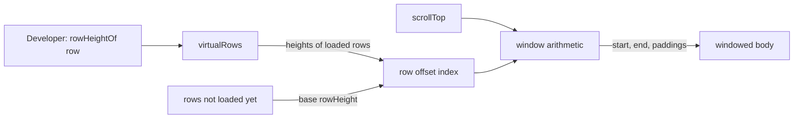

# Specification: variable row heights

> **Status**: Draft (stages 1–3 written; nothing implemented)
> **Stage entry**: 1
> **Semver impact**: minor (one optional option on `virtualRows()` and one new core helper; no default changes; see api-surface.md)

---

## 1. The consumer problem

Every row in a windowed grid is the same height. `virtualRows({ rowHeight })` takes one number, `density()`
publishes one number per level, and `computeVirtualWindow` turns a scroll offset into a row index by dividing by
it. That is what makes a million rows cheap, and it leaves a consumer with three gaps:

1. **Rows that are not alike cannot differ.** A notes column that wraps to three lines, a row flagged as a
   warning that carries a banner, a section row between groups of data: each needs more room than its
   neighbours. Today the consumer picks the tallest value for every row, or lets the tall rows overflow their slot.
2. **The overflow is not harmless.** A `<tr>` taller than its declared height grows, the spacers above and below
   no longer add up to the real content, and the scrollbar drifts from the rows it stands for.
3. **The workaround is not available.** A consumer cannot hand the windowed body a height per row, because the
   seam takes a number. They either give up virtualization or fork the body.

## 2. User stories

- **US-01.** As a developer, I want to say how tall each row is from its data, so a row with more to show can have
  more room without every other row paying for it.
- **US-02.** As a developer, I want that to be opt-in, so a grid that gives a single `rowHeight` behaves
  exactly as it does today.
- **US-03.** As a person scrolling a large grid, I want the scrollbar, the rows on screen and "scroll to row N" to
  agree whatever the row heights are.
- **US-04.** As a developer using a remote or windowed source, I want rows that have not arrived to take a
  predictable height, and I want to be told, not surprised, when the scrollbar adjusts as they arrive.
- **US-05.** As a developer using `density()`, I want per-row heights to sit on top of the chosen level instead of
  fighting it.
- **US-06.** As a person using a keyboard or a screen reader, I want nothing about row order, `aria-rowindex` or
  focus to change because some rows are taller.

## 3. Acceptance criteria

**The option**

- **AC-01.** `virtualRows({ rowHeightOf })` accepts `(row, absoluteIndex) => number | undefined`. A returned
  positive finite number is that row's height in pixels. `undefined`, `0`, a negative, `NaN` or `Infinity` means
  "the base height", never an error and never a zero-height row.
- **AC-02.** Without `rowHeightOf` nothing changes: the same markup, the same arithmetic, the same `scaled`
  behaviour. A snapshot of the windowed body is byte-identical to the one before this change.
- **AC-03.** The base height is what `virtualRows()` uses today, in the same order: the height an earlier add-on
  published (`density()`), then `rowHeight`, then `40`. `rowHeightOf` refines it per row; it does not replace the
  density level.
- **AC-04.** `rowHeightOf` is called only for rows the grid is holding, at most once per row per data version, and
  never during scrolling. A scroll that reveals already-seen rows calls it zero times.
- **AC-05.** A `rowHeightOf` that throws loses its own effect and nothing else: that row takes the base height, the
  error is reported through the grid's existing add-on error path, and the grid keeps rendering.

**Position arithmetic**

- **AC-06.** For any mix of heights, the spacer above the rendered rows equals the sum of the heights of every row
  before the first rendered one, and the spacer below equals the sum after the last. The three add up to
  `scrollHeight`.
- **AC-07.** The row at a scroll offset is found in O(log n) from the number of rows with a custom height, not
  O(n) from the number of rows. Rows with the base height cost nothing to store.
- **AC-08.** `scrollToIndex(i)` lands row `i` at the top of the viewport (or as near as the scroll range allows),
  and reading back the first visible row returns `i`. This holds with custom heights above and below `i`.
- **AC-09.** Past `MAX_SCROLL_HEIGHT`, the grid scales exactly as it does today: the scrollbar becomes a ratio
  of the total height, and `scaled` is `true`. Custom heights contribute to the total; they do not disable scaling.
- **AC-10.** A change to the data version (sort, filter, page size, refetch, new rows) discards every recorded
  height and records them again from the rows now held. A height is never applied to a row it was not computed from.
  Moving the data window (scrolling a remote grid) is not a change of version: heights recorded for rows that have
  left the held window are kept, keyed by absolute index.
- **AC-10a.** Scrolling down 5,000 rows and back up leaves the first visible row, the spacer heights and the
  scrollbar position equal to what they were on the way down. A test drives a windowed source through that round trip.
- **AC-10b.** `rememberedRows` (default 100,000) caps how many custom heights are kept. Past it, the entries
  farthest from the first visible row are dropped back to the base height. A cap that is hit changes the scrollbar
  for rows far from the viewport only, and the documentation says so. `Infinity` removes the cap.

**Rows that have not arrived**

- **AC-11.** A row not yet loaded has the base height, whether it renders as a skeleton or as nothing.
- **AC-12.** When a window of rows arrives and some of them have custom heights, the rows above the viewport that
  change height do not move the rows the person is looking at: the add-on compensates the scroll offset by the
  difference, and a test covers a window that arrives above the viewport.
- **AC-13.** The documentation says plainly that the scrollbar of a remote grid is exact only for the rows it
  has seen, and that the total height can change as windows load.

**Rendering and accessibility**

- **AC-14.** A row with a custom height renders `style="height: Npx"` on its `<tr>`, the same mechanism the
  windowed body uses now. Skeleton rows use the base height.
- **AC-15.** Row order, `aria-rowindex`, `aria-level`, selection, focus and the live region are unchanged. A
  test with mixed heights asserts the rendered `aria-rowindex` sequence equals the one with uniform heights.
- **AC-16.** A custom height is a minimum, as a table row's height is: content taller than the declared value makes
  the row taller than the arithmetic believes. The documentation says so, and says what to do (return a larger
  number), because measuring content is a non-goal here.

**Documentation and proof**

- **AC-17.** `docs/virtualization.md`, `docs/api.md`, `docs/addons.md` (if the seam is public), `README.md` and
  `CHANGELOG.md` carry the new option; the playground has a windowed grid with mixed heights that has been
  scrolled, sorted, filtered and jumped through in a browser, with `density()` switched across its levels.
- **AC-18.** Per-row work stays off the hot path (`.agents/rules/performance.md` section 8): a scroll event
  allocates no per-row objects for rows with the base height, and a benchmark with one million rows and one
  percent custom heights is recorded in `research.md`.

## 4. Non-goals

- **No measured heights.** The grid does not observe the DOM to learn how tall a row turned out. That needs a
  per-row `ResizeObserver`, feedback between layout and the window, and a second source of truth for position.
  It is a different feature with a different cost model, and `rowHeightOf` leaves room for it.
- **No per-row heights without `virtualRows()`.** A paged body lets the browser lay rows out by content; it
  needs no height from the grid. This feature is about the windowed body's arithmetic.
- **No per-column or per-cell height.** A row has one height.
- **No change to the default.** One number remains the default path, and the fastest.
- **No animation.** Heights are not transitioned; a row that changes height changes at once.
- **No height in the engine's row model.** Height is presentation, so it does not appear on `GridRow` or in state.
- **No row resizing by the person.** A drag handle on a row border is a separate interaction with its own
  accessibility work.

## 5. Behaviour across the capability seam

Height is presentation. It does not touch the query, the pipeline or the data source.

| Source resolves | Expected behaviour |
| :--- | :--- |
| nothing (local array) | Every row is held, so every height is known up front for the current version. The scrollbar is exact. |
| everything (server) | Only the loaded window is held; the rest take the base height. The scrollbar is exact for what has been seen and is corrected as windows arrive (AC-12, AC-13). |
| pagination only | The same as a server: rows held are the current page; unseen rows are base height. |

Totals are never invented: `state.totalRows` and `isTotalExact` are read as they are. A row count of "many"
still produces a scrollbar from the count the grid has, as it does now.

## 6. Accessibility and interface copy

- No new control and no new visible string, so nothing is added to `labels` or to any locale pack.
- `aria-rowindex` is computed from the absolute index, not from height, and is unchanged (AC-15).
- Taller rows do not change tab order, the roving focus target or what a live region announces.
- Reduced motion: nothing animates.

## 7. Delivery as a plugin

A React add-on only: an option on the existing `virtualRows()` (`gridwright:virtual`). The arithmetic is headless
and goes in `src/core/virtual.ts` beside `computeVirtualWindow`, as a function over a row-offset index with no
DOM and no React, so a page without a framework can call it. The windowed body reads it through public exports
only. Nothing new is added to the add-on contract: `density()` still publishes its single base height through
`AddonContribution.rowHeight`, and `rowHeightOf` refines it inside `virtualRows()`.

## 8. Clarifications

| # | Question | Resolution |
| :--- | :--- | :--- |
| C-1 | A new option, or widen `rowHeight` to `number \| function`? | A new option, `rowHeightOf`. `rowHeight` keeps one meaning (the base height) and its type stays `number`, so a consumer or third-party add-on that reads it as a number does not break. |
| C-2 | Why a function and not an array or a map? | Heights depend on row data, rows arrive in windows, and a million-row array of heights is the cost this design avoids. A function is called once for rows the grid holds. |
| C-3 | What does the function receive? | `(row, absoluteIndex)`: the row as the grid holds it, and its position in the whole result set. Never the DOM, never a column. |
| C-4 | What about group, tree and detail rows? | Data rows only. Rows another add-on renders (group header, custom rows) take the base height until a second spec says otherwise. A row-detail panel is not part of its parent's slot; the plan checks how it is windowed today and records the answer before stage 6. |
| C-5 | How does `density()` combine with it? | The level sets the base height; `rowHeightOf` returns absolute pixels for rows that differ. A consumer who wants rows relative to the level reads `useDensity()` inside their callback. (A multiplier is rejected: it makes two sources of truth for one number.) |
| C-6 | Is a custom height a minimum or an exact height? | A minimum, because it is a table row's height (AC-16). Exactness would need `display: block` rows, which loses column alignment and grid semantics; the existing body already refuses that. |
| C-7 | Where are heights stored? | A sparse index of rows that differ from the base, rebuilt per data version (AC-10). A million uniform rows store nothing. |
| C-8 | Should heights persist across a sort? | No. Absolute positions change on sort, so heights are recomputed from the rows held (AC-10). |
| C-9 | Is `rowHeightOf` called during render? | It is called when rows are recorded, not per frame (AC-04). The result is cached per row id and version, so an unrelated re-render costs nothing. |
| C-10 | Forget heights when rows leave the held window? | No. Forgetting changes the sum above the viewport on every window move, so content shifts under the reader, a scroll back up lands rows at different heights, and jump-to-row is computed from forgotten numbers. Heights are kept until the data version changes (AC-10), bounded by `rememberedRows` (AC-10b) so a very large grid cannot grow without limit. |

## Artifacts not written

- `data-model.md`: no state or type changes shape; the one new option and the index type are in api-surface.md.
- `events.md`: no event is emitted and no pipeline stage is added.
